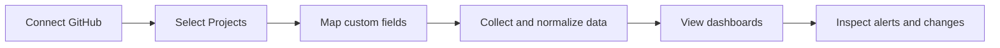
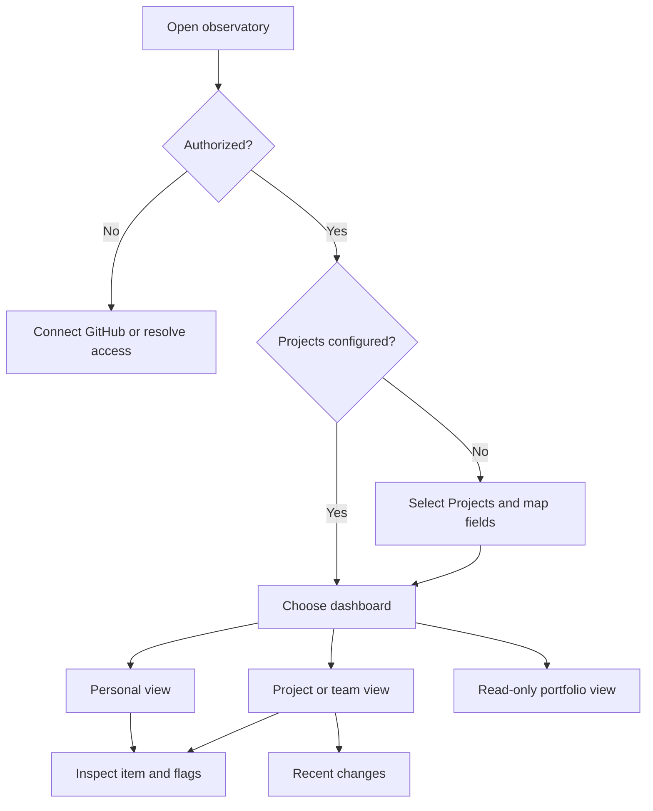

# GitHub Projects Portfolio Observatory

This document specifies the intended **functional behavior** of LG-05. The proposed behaviors below are subject to supervisor feedback; technical implementation choices belong to the later technical-proposal section.

## 1. Actors and permissions

| Role | Needs | Responsibility / access |
| --- | --- | --- |
| Connected user / contributor | See relevant assigned work and recent changes | Authenticates with GitHub; views authorized Projects and personal dashboard |
| Portfolio administrator / project configurator | Monitor multiple Projects consistently | Selects authorized Projects, configures field mappings and monitoring thresholds, and views comparison dashboards |
| Team or office lead | Identify risks and workload across selected Projects | Views project/team dashboard and relevant work-item details within granted access |
| Company / wall viewer | Understand portfolio condition at a glance | Read-only access to an explicitly permitted summary; cannot change mappings or integration settings |

These are **application roles**. Access to GitHub data is additionally limited by the GitHub permissions granted to the integration. A user's application role never overrides GitHub authorization.

## 2. Use cases / user stories

### UC-01 — Connect and select GitHub Projects
- **Actor:** Connected user / portfolio administrator.
- **Precondition:** The user can authenticate and has permission to access at least one GitHub Project.
- **Main flow:**
  1. The user initiates GitHub connection.
  2. The system requests authorized access and retrieves the Projects available to the user/integration.
  3. The user selects at least one Project to monitor.
  4. The system confirms the selected Projects and shows their connection state.
- **Alternative / error flows:** If authorization fails, permissions are insufficient, or the API is unavailable, the system explains the problem and does not falsely mark the Project as connected.
- **Postcondition:** The selected Projects are recorded for monitoring, subject to continuing authorization.

### UC-02 — Map different Project fields
- **Actor:** Portfolio administrator / project configurator.
- **Precondition:** A Project has been selected and its available fields can be read.
- **Main flow:**
  1. The system lists available fields and relevant field values.
  2. The user maps local fields or values to common status, priority, and assignee concepts; a due date is optional.
  3. The system previews normalized example items.
  4. The user confirms the mapping.
  5. The system saves the mapping for that Project.
- **Alternative / error flows:** Missing or incompatible fields are shown as unmapped or unsupported; the system does not silently invent values.
- **Postcondition:** Work items from that Project can be displayed using the configured common model.

### UC-03 — Review personal and team dashboards
- **Actor:** Contributor or team/office lead.
- **Precondition:** At least one monitored Project has available data.
- **Main flow:**
  1. The user opens the dashboard.
  2. The system displays normalized items and the time of the latest successful collection.
  3. The user selects a personal or project/team view.
  4. The user filters or opens a flagged item to see its source Project and relevant details.
- **Alternative / error flows:** When no data exists, show an empty state; when data is old because collection failed, show a visible freshness warning.
- **Postcondition:** The user can identify relevant work and follow the source item in GitHub.

### UC-04 — Configure and inspect monitoring rules
- **Actor:** Portfolio administrator / team lead.
- **Precondition:** Project data has been mapped sufficiently for the selected rule.
- **Main flow:**
  1. The administrator sets a stale-item threshold and, where applicable, a soon-due window.
  2. The system evaluates supported monitoring conditions.
  3. The dashboard groups or marks stale, overdue, soon-due, blocked, unassigned, and high-priority items.
  4. The user opens a flagged item and sees why it was flagged.
- **Alternative / error flows:** Unsupported conditions are labelled unavailable or not configured, rather than treated as negative results.
- **Postcondition:** Supported rule results are visible and explainable.

### UC-05 — Inspect recent important changes
- **Actor:** Contributor or team/office lead.
- **Precondition:** At least two historical observations are available for the relevant items.
- **Main flow:**
  1. The user opens the recent-changes view.
  2. The system compares retained observations.
  3. The system lists detected changes to status, priority, assignee, or due date on high-priority work items.
  4. The user opens a change to see the old and new values, source item, and detection time.
- **Alternative / error flows:** If no earlier observation exists, show that change history is not yet available. A difference detected between observations must not be presented as an exact GitHub edit timestamp.
- **Postcondition:** The user can review detected significant changes over time.

### UC-06 — View read-only portfolio summary
- **Actor:** Authorized company/wall viewer.
- **Precondition:** An administrator has made an appropriate portfolio summary available to this viewing mode.
- **Main flow:**
  1. The viewer opens the portfolio summary.
  2. The system displays concise project status, relevant indicators, and data freshness.
  3. The viewer can observe the summary without configuration or edit controls.
- **Alternative / error flows:** Unauthorized access is denied; unavailable data is clearly labelled.
- **Postcondition:** The viewer sees only the portfolio information allowed for this mode.

### Initial user journey

## 3. Functional requirements

Priority: **Must** = required by the LG-05 brief; **Should** = valuable enhancement or proposed usability behavior; **Could** = optional extension.

| ID | Requirement | Acceptance criteria | Priority |
| --- | --- | --- | --- |
| FR-01 | Authenticate and access only authorized GitHub Projects. | Given valid authorization, available Projects can be listed; given denied or expired authorization, protected data is not shown and an actionable error appears. | Must |
| FR-02 | Configure multiple monitored GitHub Projects. | Given access to two Projects, when both are selected, both appear in the monitored-project list and dashboard data. | Must |
| FR-03 | Configure project-specific field mappings. | Given Projects with different labels, when mappings are saved, equivalent source values display under common status, priority, and assignee concepts, with optional due date. | Must |
| FR-04 | Display normalized work items with source context. | Given collected items, when a dashboard opens, each visible item includes its source Project and normalized available fields. | Must |
| FR-05 | Show a personal dashboard. | Given an authenticated user with assigned items, when the personal view opens, items relevant to that user's mapped identity are highlighted. | Must |
| FR-06 | Show a project/team comparison dashboard. | Given at least two monitored Projects, when the comparison view opens, users can distinguish and compare their available work and indicators. | Must |
| FR-07 | Provide a read-only company/wall view. | Given a permitted viewer, when the summary opens, it displays portfolio indicators but no controls to edit mappings or monitoring configuration. | Must |
| FR-08 | Detect stale open items using a configurable period. | Given an open item with no detected change for longer than the configured period, when rules run, the item is flagged stale; closed items are not. | Must |
| FR-09 | Identify overdue and soon-due items where dates exist. | Given a mapped due date and defined date window, an open item past its deadline is overdue and one within the future window is soon due. | Must |
| FR-10 | Identify blocked, unassigned, and high-priority items when supported. | Given mapped values or supported assignee information, matching items are flagged; without a usable mapping, the indicator is marked unsupported. | Must |
| FR-11 | Retain historical observations. | Given two successful collections with changed values, the earlier and later observations remain available for comparison. | Must |
| FR-12 | Show changes on high-priority items. | Given observed changes in status, priority, assignee, or due date for a qualifying high-priority item, the change feed displays the before/after values and observation time. | Must |
| FR-13 | Communicate empty, loading, authentication, permission, rate-limit, and API-error states. | Given each simulated condition, the interface displays a distinct understandable state rather than silently showing misleading data. | Must |
| FR-14 | Show freshness of displayed data. | Given stored observations, the dashboard shows when collection last succeeded and warns when displayed data may be outdated. | Should |
| FR-15 | Link displayed work items back to GitHub. | Given an item with a valid source URL, selecting its source link opens the original GitHub item. | Should |
| FR-16 | Offer AI-generated portfolio summaries. | If added later, the user can request a summary clearly identified as AI-generated and grounded in available observations. | Could |

## 4. Business rules and constraints

| Rule or constraint | Rationale |
| --- | --- |
| The observatory is a monitoring layer, not the system of record. | GitHub Projects remains the authoritative source for work items. |
| Only authorized Projects and information may be retrieved or displayed. | Application permissions must not bypass GitHub permissions. |
| Each Project's custom fields and values must be explicitly mapped where meanings differ. | A label such as `Doing` cannot safely be assumed to mean `In Progress` everywhere. |
| A stale item is **open** and has no **observed relevant change** for longer than a configurable period. | Staleness requires a documented open/closed mapping and change definition; the first collection alone cannot establish a reliable historical unchanged period. |
| Overdue means an open item has a mapped due date earlier than the evaluation date; soon-due means its date falls within a configurable upcoming window. | Avoids treating missing due dates as overdue and keeps timing explainable. |
| Blocked and high-priority classifications require configured, supported source values. | These concepts are not guaranteed to exist in every GitHub Project. |
| Unassigned means no assignee is present in the supported source data. | Avoids inferring ownership from unrelated fields. |
| Change feed entries reflect differences between observations, not necessarily every intermediate edit. | Periodic collection may miss changes that happen and are reversed between observations. |
| If data is missing, outdated, or collection fails, the interface must not imply that all Projects are healthy. | Prevents misleading portfolio decisions. |
| The company/wall view is read-only and must have a defined authorization boundary. | A display mode must not expose unauthorized private Project details. |

## 5. User interface and workflow

The intended navigation includes: **Connections / Monitored Projects**, **Field Mapping**, **Personal Dashboard**, **Project/Team Dashboard**, **Company/Wall View**, and **Recent Changes**. The dashboard presents concise counts or indicators with drill-down to source items. The configuration area explains unmapped fields and allows the user to preview mappings before saving. Every monitoring view includes clear data-freshness feedback.

**Wireframe plan (not yet approved):** create one low-fidelity wireframe each for Project Selection / Mapping, Personal Dashboard, Team Dashboard, and Wall View. Validate that a viewer can identify the most important flagged work without reading technical documentation.

## 6. Non-functional requirements

| Requirement | How it will be verified |
| --- | --- |
| Integration secrets and tokens are not embedded in browser-delivered code or committed to Git. | Repository inspection, build-output inspection, and a basic security review. |
| Access to protected portfolio information respects the defined user and display roles. | Authorization tests for a permitted and a denied viewer. |
| Projects with different custom fields remain usable without source-specific code changes. | Normalization tests with at least two contrasting sample Project configurations. |
| Rule results are deterministic for a given normalized item, configuration, and evaluation time. | Automated tests for stale, overdue, soon-due, blocked, and unsupported cases. |
| GitHub integration handles pagination and errors without silently discarding information. | Integration-boundary tests with paginated, denied, and rate-limited responses. |
| Failed collection does not overwrite previously stored valid observations. | Simulated collection-failure test and history integrity check. |
| A new user can identify how to connect a Project and understand why an item is flagged. | Short usability walkthrough with representative tasks. |
| The interface remains understandable when there are no Projects, no matching items, or no history yet. | Manual UI checks for each empty-state scenario. |

Quantitative performance and data-retention targets remain to be agreed after investigating representative Project sizes and API constraints.

## 7. Open questions and risks

| Question / risk | Impact | Owner | Resolution / decision |
| --- | --- | --- | --- |
| What exact source statuses count as open or closed? | Stale and due-date logic | Student + supervisor | Define configurable status categories and test examples. |
| How will users be authorized for team and company dashboards? | Privacy and access | Student + supervisor | Agree on access rules before implementation. |
| What is the default stale threshold and soon-due window? | Alert usefulness | Student + supervisor | Propose defaults, then validate with examples. |
| How often must observations be collected? | Historical accuracy, cost, API limits | Student | Compare collection approaches in technical proposal. |
| What counts as a relevant change for staleness? | False positive/negative stale flags | Student + supervisor | Define monitored fields and document limitations. |
| How should an item changing from or to high priority appear in the feed? | Change feed semantics | Student + supervisor | Specify whether either state qualifies and test both. |
| What is the intended role of cost-efficient AI summaries? | Scope and operational cost | Student + supervisor | Investigate as an extension; do not make it a Presentation-1 dependency. |
| How should disconnected Projects and partial collections be represented? | Reliability of dashboards | Student | Define freshness and error behavior before implementation. |

## 8. Initial technical specification proposal

**Deferred to Presentation 2 / the later semester-1 technical proposal.** The official brief requires TypeScript and the official GitHub Projects v2 API, including GraphQL where appropriate. Candidate architecture, storage of historical observations, scheduling, authentication approach, technology alternatives, cost, deployment, and feasibility tests will be researched and justified rather than selected without evidence.
