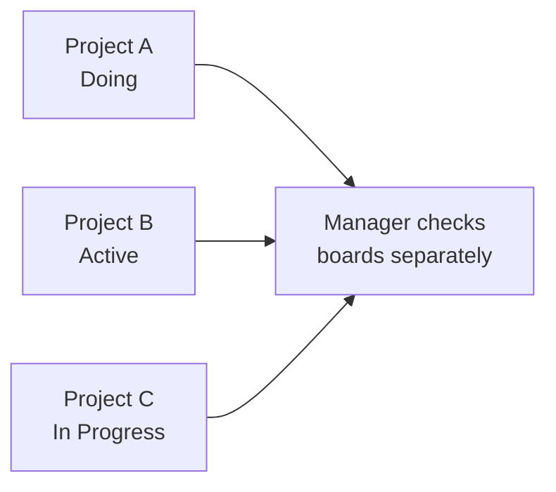
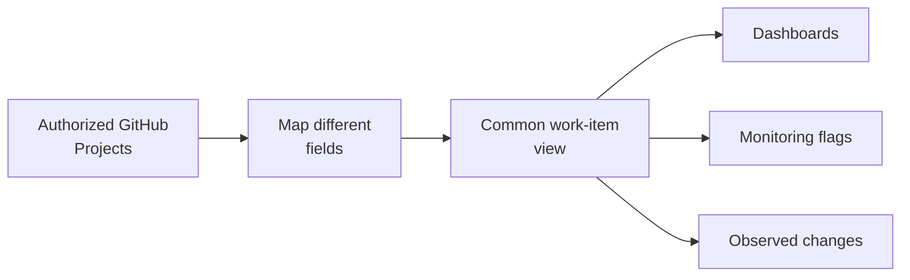
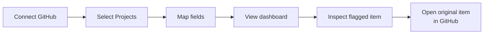

<!-- 5xl -->
# GitHub Projects Portfolio Observatory

**One clear view across multiple GitHub Projects**

Ahmed Al-Jarmoozi  
Neptun: Y8AJ2T  
Supervisor: Gergely Laborci  
Project ID: 2026-LG-05

---

## The problem: fragmented visibility

- Several GitHub Projects, different workflows
- Different status and priority labels
- No simple portfolio-wide view of risks and changes

---

## Who needs this?

- **Contributor:** What needs my attention?
- **Team lead:** Which work is delayed or blocked?
- **Portfolio administrator:** How do projects compare?
- **Wall viewer:** What is the overall picture?

---

## The proposed solution

**Monitor and explain work — do not replace GitHub Projects.**

---

## User journey: from connection to insight

**Example:** `Doing`, `Active`, and `In Progress` can be mapped to a shared meaning when appropriate.

---

## What will the observatory show?

- **Personal view:** work relevant to me
- **Team view:** compare monitored projects
- **Wall view:** read-only portfolio overview
- **Monitoring:** stale, overdue, soon-due, blocked, unassigned, high-priority
- **History:** important changes detected between collections

*Indicators appear only when source data supports them.*

---

## Scope and boundaries

| In scope | Not the goal |
| --- | --- |
| Connect multiple authorized Projects | Replace GitHub Projects |
| Map fields into a common model | Modify source tasks from the observatory |
| Dashboards, rules, historical observations | Promise every GitHub edit is captured |
| Clear access and error states | Depend on AI to make core monitoring work |

---

## What would success look like?

- Two differently configured Projects can be viewed together
- Their mapped work items are comparable
- A user can find a flagged item and understand **why**
- Recent observed changes can be inspected
- Unavailable or outdated data is clearly labelled

**Outcome:** less manual checking, more actionable visibility.

---

## Next steps

- Validate user journeys and monitoring definitions
- Refine specification and low-fidelity wireframes
- Investigate implementation options for Presentation 2
- Explore cost-efficient AI summaries as a possible extension

**Questions?**
