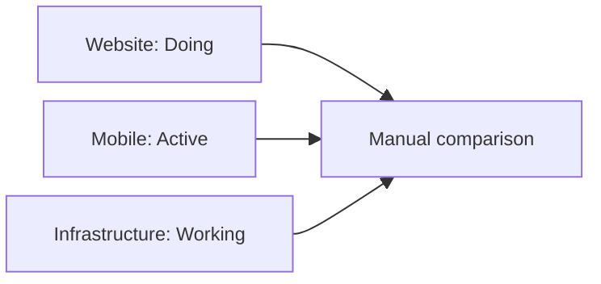
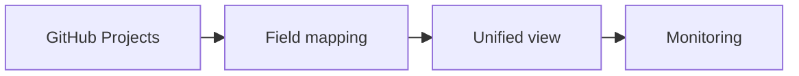
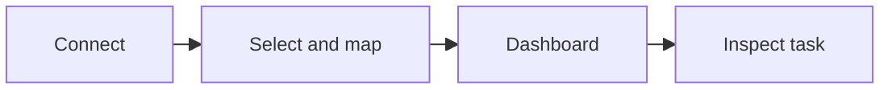

<!-- 5xl -->
# GitHub Projects Portfolio Observatory

**One clear view across multiple GitHub Projects**

Ahmed Al-Jarmoozi  
Neptun: Y8AJ2T  
Supervisor: Gergely Laborci  
Project ID: 2026-LG-05

---

## The problem: fragmented visibility

**Different workflows make portfolio-wide monitoring harder.**

---

## Who needs it?

- **Contributors:** Their assigned work
- **Team leads:** Delays and blocked tasks
- **Portfolio administrators:** Cross-project comparisons
- **Wall viewers:** Permitted read-only overview

---

## The proposed solution

**Compare work consistently without replacing GitHub Projects.**

---

## User journey: from connection to insight

**A flagged task links back to its original GitHub item.**

---

## What will users see?

- **Personal view:** Relevant assignments
- **Team view:** Compare projects and risks
- **Wall view:** Authorized read-only summary
- **Monitoring:** Stale, overdue, blocked and other supported indicators
- **History:** Changes detected between observations

*Missing or unsupported information is clearly labelled.*

---

## Scope and boundaries

**Included:** Authorized connections · Field mapping · Dashboards · Monitoring · Historical observations

**Not the goal:** Replacing GitHub Projects · Editing original tasks · Capturing every edit · Depending on AI for core features

---

## What does success look like?

- Two differently configured Projects appear together
- Equivalent fields display consistently
- Flagged tasks explain **why** they need review
- Important observed changes can be inspected
- Outdated or unavailable data is clearly labelled

**Less manual checking. More actionable visibility.**

---

## Next steps

- Validate user journeys and monitoring definitions
- Refine wireframes and specification
- Investigate technical options for Presentation 2
- Consider AI summaries as an optional extension

**Questions?**
